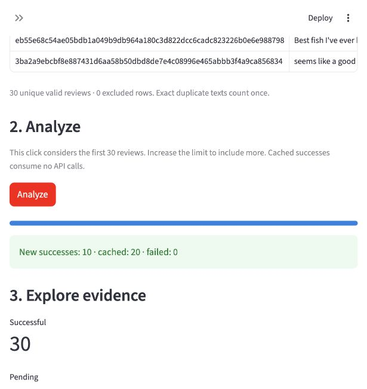
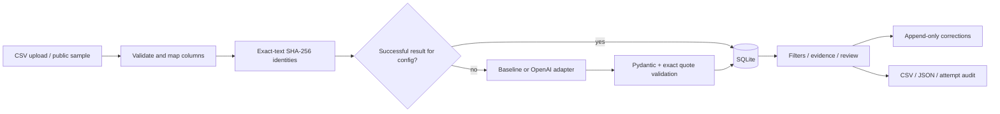

# Customer Feedback Intelligence

A tool for answering three questions about customer feedback: **What are customers talking about? Which reported problems deserve investigation? What evidence supports each finding?**

Upload a review CSV, classify topics and sentiment, inspect the original comments, correct classifications, and export the analysis. Reported problems are ranked with an explicit frequency-and-severity heuristic.

Built by **Jamille Rocha Ghazaleh** with Python, Streamlit, Pydantic, pandas, SQLite, and an OpenAI API adapter.

| Available now | Still pending |
|---|---|
| Complete local CSV-to-export workflow | Real LLM execution and comparison with the baseline |
| Offline keyword baseline and recorded evaluation | Independent human theme/severity labels |
| Structured LLM adapter, validation, retries and cache | Deployment and production validation |
| Human corrections with preserved machine outputs | Business impact measurement |

**Try it without an API key:** the bundled public sample runs with a clearly labeled keyword baseline. The OpenAI integration is implemented and tested with mocked responses; real model quality, latency and costs have not been measured. No application is publicly hosted.

<details>
<summary>Screenshot: local baseline run, 30 reviews processed</summary>



</details>

## Run locally

Development and validation used Python 3.9.6 on macOS ARM64. The version lock records that environment; other Python/OS combinations have not yet been validated.

```bash
git clone https://github.com/jamillerochagh/customer-feedback-intelligence.git
cd customer-feedback-intelligence
python3 -m venv .venv
source .venv/bin/activate
python -m pip install -r requirements-lock.txt
streamlit run app.py --server.address 127.0.0.1 --browser.gatherUsageStats false
```

Open the local URL shown by Streamlit. Use **Public sample → Analyze → Open original review → Export**. The default engine is **Keyword baseline · local demo**: deterministic English keyword rules, not simulated LLM output. The bundled sample needs no download, key, or network access.

For real analysis, copy `.env.example` to `.env`, set `OPENAI_API_KEY`, restart the application, and choose **OpenAI · real LLM**. Never commit `.env`. The adapter uses the configurable `gpt-4.1-mini-2025-04-14` snapshot; account access and availability must be verified by a real run. No automatic fallback hides API failures. Start with 5–20 public reviews. Only an explicit Analyze click sends review text to the provider. Local/private storage does not imply the provider processes data locally.

`requirements-lock.txt` records all installed versions from the tested environment; `requirements.txt` describes direct compatibility ranges. Other operating systems/Python versions may require resolving their own lock. No FastAPI server, vector database, agents, or model training is needed for this single-user workflow.

## Workflow and demo

1. Load a UTF-8 comma-separated CSV (5 MB / 5,000 rows maximum).
2. Map text and optional date/rating columns. Preview excluded rows. Ratings are preserved as strings and not assumed to share a common scale. Use ISO dates to avoid ambiguous parsing.
3. Select an engine and a per-click cap (maximum 100 reviews). Processing considers the first N accepted unique reviews; increase the cap to include more. The tool never silently processes the entire file.
4. Explore theme, sentiment, and date filters; open original text and its exact evidence quote.
5. Correct a classification with reviewer and reason; the original machine output remains intact.
6. Export all accepted reviews, including pending/failed statuses, plus configuration and processing audit.

See [the short demo and interview guide](docs/DEMO.md). Versioned [baseline predictions](examples/baseline-evaluation/predictions.json), [errors](examples/baseline-evaluation/errors.json), and [execution measurements](examples/baseline-evaluation/report.json) are genuine local baseline outputs on public data. They are not LLM examples.

## Architecture



`cfi/ingest.py` preserves raw text; `models.py` defines the contract; `providers.py` isolates network access; `pipeline.py` handles cache/recovery; `store.py` persists machine results, attempts and corrections; `reporting.py` exports and ranks; `app.py` coordinates the UI. Replacing a provider requires implementing `classify(text) -> ProviderResult` and extending the configuration/engine selection, without changing ingestion or reports.

The cache key combines exact-text SHA-256 with provider, model, prompt version and hash, schema hash, temperature, output limit, and pipeline version. Exact duplicate texts count once and are listed in the ingestion report. Dates, rating, and source row remain attached to the current upload, preventing metadata from an earlier upload from overwriting current context. Text hashes are identifiers, not anonymization. Successful results are reused; failures are retried on the next click. Changing extraction/postprocessing rules requires a version bump. Model aliases can drift; prefer snapshots.

SQLite is intentionally local and single-user. It is not an authenticated service. Do not expose it publicly. Results and potentially sensitive originals are stored in `local/`, ignored by Git. Files are retained until the operator deletes them. There is no multi-worker job claiming; concurrent sessions could issue duplicate requests before either commits a success.

## Classification and priorities

The [taxonomy](docs/ANNOTATION.md) contains five primary themes: product quality, service, speed, price, and other. Sentiment is positive, negative, neutral, mixed, or uncertain. Severity is an ordinal **reported** problem score (0–3), not verification of an allegation. A single primary theme keeps the MVP understandable, but loses secondary issues.

Each output requires a nonblank literal substring from the original review. Pydantic rejects unknown fields, invalid labels/ranges, inconsistent issue/severity combinations, and uncertainty without a review flag. Quote matching verifies provenance only: an irrelevant or misleading quote can still pass. Semantic correctness needs evaluation and human review. Confidence is not calibrated.

Priority score = sum of reported severity across unique reviews with a reported problem in the selected theme. The UI also shows problem count, share of successfully analyzed reviews, maximum severity, review flags, and supporting IDs. Rankings follow the current filters. Failed/pending rows are excluded from the denominator, so partial processing can bias results. A score assumes equal weights and an ordinal scale treated as additive; it is an explicit heuristic, not expected revenue or a validated decision rule. No recency weighting is applied. Any severity-3 allegation deserves manual inspection independently of its frequency.

Suggested actions are deliberately labeled **hypotheses**: inspect the cases before selecting an intervention. Verification plans require comparable windows and manual confirmation; causal impact needs an appropriate experiment. No generated root cause or savings is presented as fact.

## Reliability and safety

- Strict structured output via OpenAI Chat Completions, then independent local validation.
- Fixed HTTPS provider endpoint, 30-second read timeout, bounded 3-attempt retries for transport failures, HTTP 429 and 5xx (1s/2s backoff). Authentication/schema errors, refusal, incomplete output and invalid evidence become explicit row failures.
- Each attempt records status, safe error code, latency, returned model, and available token counts. One failed row does not stop the batch. Process interruption may leave an attempt without a final result; a rerun handles that row again.
- Review text is JSON-encoded in a user message; the versioned system prompt treats it as untrusted data. No tools, code execution, retrieved instructions, or automatic actions are available to the classifier. This reduces consequences of prompt injection but cannot guarantee classification resistance. Malicious text still needs adversarial real-model evaluation.
- Secrets come from environment variables and are never stored in the configuration/audit. Raw API errors are not displayed or persisted. The request sets `store=false`; consult provider policies for broader retention terms.
- CSV exports and displayed tables (including their built-in CSV downloads) escape spreadsheet formula prefixes. The original-review view, JSON and SQLite preserve exact text. Uploaded content is displayed as text/table data, never rendered as HTML.

Recorded token totals exclude usage not returned by failed/invalid requests, and are lower bounds. Optional `CFI_INPUT_PRICE` and `CFI_OUTPUT_PRICE` (USD per million tokens) enable an estimate from operator-verified prices in the UI. No prices or dollar savings are invented. API timeouts may have been processed and billed by the provider even if retried.

## Data and evaluation

Public data: [UCI Sentiment Labelled Sentences](https://archive.ics.uci.edu/dataset/331/sentiment+labelled+sentences), Kotzias (2015), [DOI](https://doi.org/10.24432/C57604), [CC BY 4.0](https://creativecommons.org/licenses/by/4.0/). Based on *From Group to Individual Labels Using Deep Features*, Kotzias, Denil, de Freitas and Smyth, KDD 2015. We use restaurant-review sentences from its Yelp subset. Source labels are binary sentiment annotations, independent of this project's model. See [data attribution](data/README.md) and [provenance and hashes](data/provenance.json).

Transformations: preserve exact text, remove exact duplicates, shuffle with seed 42, separate 30 demo and 60 held-out evaluation sentences. No dates or ratings are fabricated. The original source is balanced toward clearly positive/negative sentences, so the sample is not representative of natural feedback, Portuguese, neutral/mixed sentiment, delivery platforms, or iFood. It is not affiliated with iFood. No source sentiment labels are sent to the provider.

```bash
python -m pytest -q
python -m scripts.evaluate --engine baseline
# Real API calls on 60 held-out public reviews; consumes API credits:
python -m scripts.evaluate --engine openai --output local/llm-evaluation
# After independent human annotation (do not overwrite the blank template):
python -m scripts.evaluate --human-labels local/human_review_completed.csv
```

The recorded baseline run on 60 held-out sentences achieved **26.7% accuracy**, **0.415 binary macro-F1**, and **71.7% abstention** (43/60 uncertain; 0 processing failures). This exposes the limitations of the minimal keyword rules; it is not evidence that an LLM will perform better. These values come from `examples/baseline-evaluation/report.json` and must not be attributed to an LLM.

Evaluation stores raw machine predictions and never applies UI corrections. It reports accuracy, binary macro-F1, per-class precision/recall/F1, confusion counts, abstention/failure rates and error examples. Uncertain, mixed, neutral and failed predictions count as misses against binary references. Abstention is not silently discarded. Theme/severity metrics are emitted only for independently reviewed rows, with coverage and label-file hash; they remain pending otherwise. Latency statistics cover recorded attempts in the evaluation database, including previous cached runs, and exclude backoff/UI overhead. They are not deployment benchmarks.

Prepare annotations in [data/human_review.csv](data/human_review.csv) following [the rubric](docs/ANNOTATION.md), without viewing model predictions. Its theme, severity, and evidence labels are blank. No LLM-produced labels are treated as ground truth. Metrics on 60 sentences have substantial sampling uncertainty. Use this first holdout as a diagnostic benchmark; if prompts are tuned after inspecting its errors, it becomes development data and a fresh untouched test set is required before claiming generalization.

To regenerate sample files (overwrites the blank annotation template, so preserve completed labels elsewhere):

```bash
python -m scripts.prepare_data
```

## Next steps and limitations

1. Complete independent human theme/severity labels, ideally double-label a subset and adjudicate disagreements.
2. Run the real LLM on the same held-out texts; compare against the frozen baseline, inspect errors, latency, tokens and costs.
3. Test Portuguese, negation, sarcasm, multi-issue and injection cases; decide when to abstain based on measured behavior.
4. Expand the sample and reserve a fresh test set before tuning; consider multiple issue-level labels only if error analysis supports them.

Not yet demonstrated: real API connectivity, model quality, real LLM cost/latency, injection resistance, multilingual quality, causal business impact, production authentication, concurrent processing or deployment. No accuracy, users, time savings or revenue impact is claimed beyond recorded runs. The first version optimizes for a complete, inspectable local workflow.

API references consulted: [OpenAI Structured Outputs](https://developers.openai.com/api/docs/guides/structured-outputs?api-mode=chat) and [Chat Completions](https://developers.openai.com/api/reference/resources/chat/subresources/completions/methods/create).
